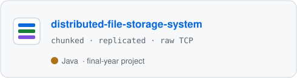
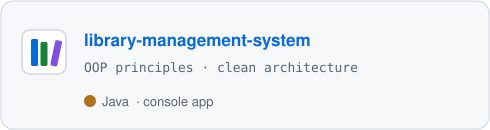

  

  
  

<h3 align="center">Stack</h3>

  

<h3 align="center">Projects</h3>

  
  

  <picture>
    <source media="(prefers-color-scheme: dark)" srcset="https://raw.githubusercontent.com/Leo-Baldwin/Leo-Baldwin/output/github-snake-dark.svg"/>
    
  </picture>

